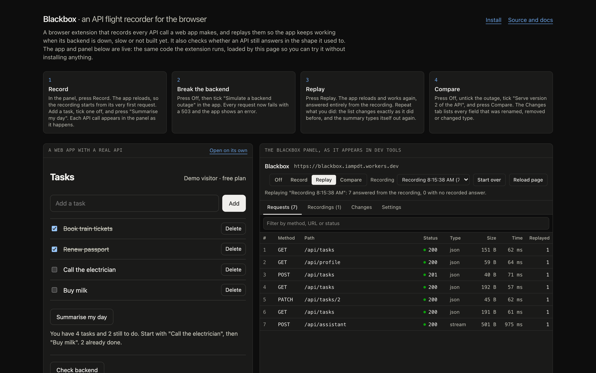
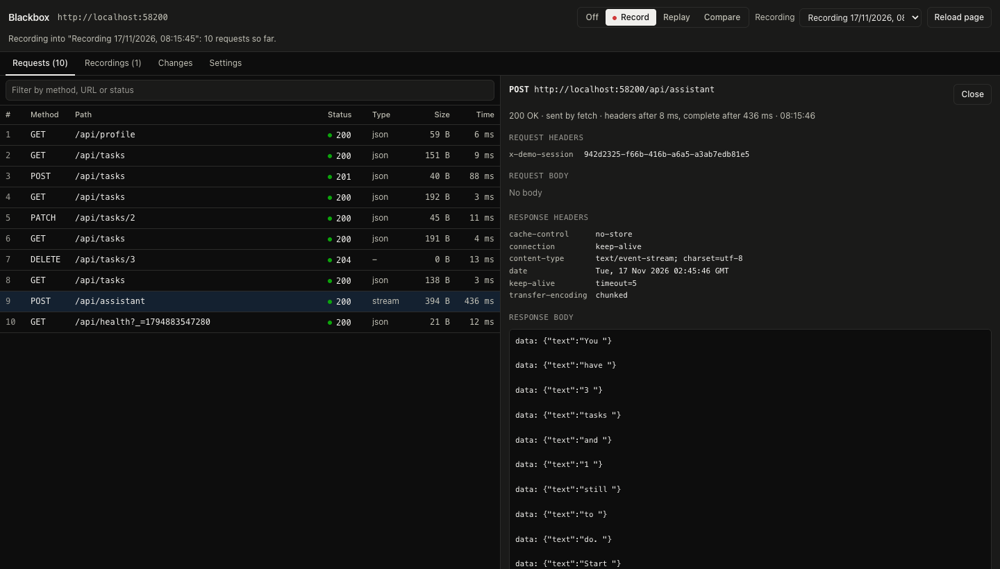
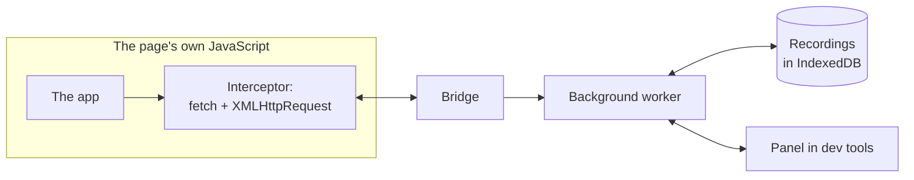

# Blackbox

**An API flight recorder for the browser.** A Chrome extension that records every API call a
web app makes, then replays them, so the app keeps working when its backend is down, slow,
rate-limited or not built yet. It can also tell you whether an API still answers in the shape
it did when you recorded it.

**Try it without installing anything: [blackbox.iampdt.workers.dev](https://blackbox.iampdt.workers.dev)**.
That page runs the extension's real interception code against a small app with a real API.
Record a session, switch the backend off, and replay.

## What it does

- **Record.** Every `fetch` and `XMLHttpRequest` call the page makes: method, URL, headers,
  body, the response, and how long it took. Streamed responses are kept piece by piece with
  their timing.
- **Replay.** The same calls are answered from the recording, with no network. A request made
  several times gets its answers in the order they were recorded, so a list fetched before and
  after a change shows the change. A streamed answer streams again.
- **Compare.** Requests go to the real backend, and each answer is checked against the
  recording: fields added, removed or changed in type.
- **Export.** As a HAR (opens in dev tools; Playwright replays it with `page.routeFromHAR`), as
  Mock Service Worker handlers, or as JSON. Passwords, tokens and keys are removed by default.
  It also imports a HAR saved from any browser.
- **Stays out of the way.** It has no access to a site until you turn it on for that site,
  and nothing it records leaves your browser.

## Install

It is not on the Chrome Web Store, which charges a registration fee. It installs from a
download in about a minute, on Chrome, Edge, Brave or any Chromium browser.

1. Download `blackbox-extension.zip` from the [latest release](https://github.com/iampdt/blackbox/releases/latest) and unzip it.
2. Open `chrome://extensions`, switch on **Developer mode**, press **Load unpacked** and choose the unzipped folder.
3. Open a site, click the Blackbox icon and press **Turn on for this site**.
4. Open dev tools and choose the **Blackbox** tab.

Or build it yourself: `npm install && npm run build`, then load `dist/extension`.

## How it works

A page's `fetch` lives in the page's own JavaScript world, where an extension's scripts
normally cannot reach. Blackbox registers two scripts for a site you turn on: one in the
page's world that replaces `fetch` and `XMLHttpRequest`, and one beside it that can talk to
the extension. Everything interesting happens in the first: it is plain code with no
extension APIs, which is why the demo page can run it with a script tag and the tests can run
it in Node.

Details: [architecture](docs/architecture.md) · [decisions](docs/decisions.md) ·
[results](docs/results.md) · [development](docs/development.md)

## The parts worth a closer look

**The first few milliseconds.** The page script is in place before any of the page's code,
but it does not yet know whether this site is being recorded, replayed or left alone: that
answer arrives from extension storage a few milliseconds later. Apps make their first
requests in exactly that gap. So until it is told, the interceptor holds requests instead of
sending them. Without this, a replay would miss the requests every app makes on load.

**The second time the same request is made.** A mock that gives a request the same answer
every time shows the old list after you add an item. Blackbox gives the nth request of a kind
the nth recorded answer. On eight scripted sessions, the replay matched the live session
after every step in all eight; with first-answer-always it matched in one.

**After a reload.** The first measurement had one session wrong: the one that reloaded the
page half-way. The reload reset the position and the app saw the list from the start of the
recording. The position is now kept where a reload does not reach, and a reloaded page
carries on, the way a real backend would not forget what you did.

**A fake `XMLHttpRequest` that libraries accept.** `fetch` can be handed a real `Response`.
An `XMLHttpRequest` cannot be swapped: the page already holds the object. So the patched
class walks that object through its ready states and events with the recorded answer, and
never calls the real `send`. A real browser caught what the Node tests could not: a
`ProgressEvent` refuses `Infinity` as a byte count.

**One interceptor, three hosts.** The extension, the demo page and the test suite all run
the same `install(host, callbacks)`. The panel is built the same way around an interface,
with one backend for the extension and one for the demo page.

## Measured

In a real Chromium with the built extension, against the sample app on a local server.
Method and full output: [docs/results.md](docs/results.md).

| | |
| --- | --- |
| Replay identical to the live session, checked after every step (8 scripted sessions) | 8 of 8 |
| The same, with every request given its first recorded answer | 1 of 8 |
| A recorded request, over one with no extension | about 1 ms slower (0.9 to 1.3 ms across three runs) |
| A replayed request | 0.1 ms, against 0.7 ms from a server on the same machine |
| Page start with Blackbox on (it holds the first requests until it knows its mode) | about 6 ms later: 9.6 ms → 15.8 ms |
| Requests reaching the switched-off backend during replay | 0 |
| Script injected into the page | 14.7 KB |

Three of my own deployed sites, recorded and then replayed with `fetch` and `XMLHttpRequest`
blocked at the network, showed the visitor exactly what they had shown live. The fourth uses
a WebSocket for its live data, which Blackbox does not intercept.

These are one machine, a local server and sessions I scripted. They show how it behaves, not
how it would on every app.

## Tests

63 unit tests and 9 browser tests.

| | |
| --- | --- |
| Interceptor, in Node | Holding requests until configured; recording; replaying `fetch` and `XMLHttpRequest`; streams at their recorded pace; resuming after a reload; comparing |
| Matching | Query and JSON key order, volatile fields, form posts, multipart boundaries; ordered answers; misses |
| Redaction and export | Credentials in headers, URLs, JSON and free text; HAR round trip; generated MSW handlers compiled and called |
| In a real browser, with the extension | Off until turned on; a session recorded then replayed with the backend switched off; a reload mid-replay; drift; export and import; Chrome stopping the background worker mid-recording |
| The demo page | Records and replays the framed app with no extension |

## Limits

- **It sees `fetch` and `XMLHttpRequest` from page scripts, and nothing else.** Not
  WebSockets, `EventSource`, `sendBeacon`, requests from service workers or web workers, or
  images and scripts.
- **A replay is a recording, not a simulation.** Do the same things in a different order and
  each kind of request still gets its own answers in order, which may not be what a real
  backend would have said. A request that was never recorded fails.
- **Synchronous `XMLHttpRequest` always goes to the network.** It cannot wait for anything.
- **Only what the page can see is recorded.** Cookies and other headers the browser adds
  itself never appear.
- **Bodies over 5 MB are kept as a prefix** and marked as cut.
- **Chromium browsers only**, loaded in developer mode: no store listing, no automatic
  updates.
- **Recordings are stored as captured**, credentials included, inside the browser. Redaction
  happens on export.

## Stack

TypeScript · Chrome extension (Manifest V3) · React · Tailwind CSS · IndexedDB · Vitest ·
Playwright · Cloudflare Workers and Durable Objects (demo)

## License

MIT
