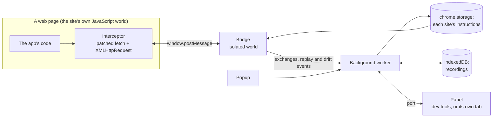

# Architecture

Blackbox has one piece of real logic, the interceptor, and three hosts that load it.

| Piece | Where | What it does |
| --- | --- | --- |
| Interceptor | `src/core/intercept.ts` | Replaces `fetch` and `XMLHttpRequest`; records, replays or compares. No extension APIs. |
| Matcher | `src/core/match.ts` | Decides which recorded answer a request gets |
| Page script | `src/extension/page.ts` | Installs the interceptor in the page's own JavaScript world, before the page's scripts |
| Bridge | `src/extension/bridge.ts` | Sits beside the page in the extension's isolated world and passes messages across |
| Background worker | `src/extension/background.ts` | Owns site state and recordings; registers the scripts for sites that are turned on |
| Store | `src/extension/store.ts` | Recordings in IndexedDB, one row per request |
| Panel | `src/ui/PanelView.tsx` | The interface. Talks only to a `Backend` interface |

## Three hosts, one interceptor

The interceptor takes a `Host` (anything with `fetch`, `XMLHttpRequest`, `Request`,
`Response` and a few more) and a set of callbacks. That is the whole of its contract, so:

- **The extension** injects it into a page and feeds its callbacks to the bridge.
- **The demo site** loads it as an ordinary `<script>` inside the sample app's frame, and
  feeds its callbacks to the panel on the same page. No extension is involved.
- **The tests** run it in Node, with a function standing in for the network.

The panel is built the same way around a `Backend` interface, with one implementation that
messages the background worker and one that keeps recordings in the demo page's memory.

## Getting into the page

A site's `fetch` lives in the page's own JavaScript world. Content scripts normally run in
an isolated world with their own copy of `window`, where replacing `fetch` changes nothing
the page can see. So two scripts are registered for each site that is turned on, both at
`document_start`:

- `page.js` in the **main** world, which can replace the page's `fetch` but has no access to
  extension APIs;
- `bridge.js` in the **isolated** world, which has extension APIs but cannot touch the page's
  JavaScript.

They talk over `window.postMessage`, each ignoring anything not from the same window and not
carrying the other's marker.

Scripts are registered per site with `chrome.scripting.registerContentScripts`, only after
the user presses "Turn on for this site". The manifest asks for no site access up front
except `localhost`; other sites are an optional permission granted at that click.

## The first few milliseconds

The page script is in place before any of the page's code runs, but it does not yet know
what to do: is this site being recorded, replayed, or left alone? That answer lives in
extension storage, which only the bridge can read, asynchronously.

A page's first requests often go out in those same milliseconds. If they went to the network
while the answer was on its way, a replay would miss exactly the requests an app makes on
load. So until it has been configured, the interceptor **holds** requests: `fetch` returns a
promise that waits, `XMLHttpRequest.send` defers. When the configuration arrives they are
recorded, replayed or released. If nothing arrives within three seconds, it gives up and lets
everything through, so a broken extension can never hang a page.

The bridge reads the configuration from `chrome.storage.local` directly, not by asking the
background worker. Chrome stops that worker when it is idle; a starting page should not
wait for it to boot.

A synchronous `XMLHttpRequest` cannot wait for anything and always goes to the network.

## Recording

`fetch`: the request is described from a clone (method, URL, headers the page set, body). The
real `fetch` runs. The response is handed to the page immediately, untouched; a clone of it
is read in the background, noting when each piece arrived. When the body ends, the exchange
is reported. A stream that arrives in several pieces spread over at least 50 ms keeps its
pieces and their timings.

`XMLHttpRequest`: the patched class extends the native one. `open`, `setRequestHeader` and
`send` note what passes through; a `loadend` listener reads the result back out.

Only what the page itself can see is recorded. Cookies and other headers the browser adds on
its own never appear, and a cross-origin response the page cannot read is recorded as such.

## Replaying

A request is reduced to a key at three levels of strictness:

| Level | Compared |
| --- | --- |
| exact | method, URL with its query sorted, the whole body (JSON with keys sorted; multipart without its random boundary) |
| relaxed | the same, minus query parameters and JSON fields listed as volatile (cache-busters, timestamps, nonces) |
| loose | method and path only; off unless asked for |

The strictest level with anything filed under it wins.

The same request is usually recorded more than once with different answers: the list, then
the list after a change. Each key keeps its answers in recorded order with a cursor. The nth
request of a kind gets the nth answer; once they run out the last one repeats.

**Across reloads.** The cursors would reset when the page reloads, sending the app back to
the first list. So the position is saved in the page's `sessionStorage` after every answer,
tagged with a session id. A reloaded page with the same session id carries on; choosing
Replay again, or "Start over", makes a new session and starts from the beginning.

**fetch** gets a real `Response`: recorded status, headers (minus `content-encoding` and
`content-length`, since the body is already decoded), and body. A recorded stream is
replayed as a `ReadableStream` that emits the pieces, at the recorded pace if asked.

**XMLHttpRequest** has no object to hand back: the page already holds the request object. The
patched class overrides the getters (`readyState`, `status`, `response`, `responseText`,
headers) and walks the object through `loadstart`, the ready states, `progress`, `load` and
`loadend`, without ever calling the native `send`.

A request with no recorded answer fails as a network error by default (`TypeError` for
`fetch`, an `error` event for `XMLHttpRequest`), so nothing reaches a real backend by
accident. It can be sent to the network instead.

## Comparing

In compare mode requests go to the network as usual. Each answer is matched to its recorded
counterpart and compared by shape: status, content type, and for JSON the set of fields and
their types at every depth. Values are expected to differ; `null` on either side is treated
as an optional field; an array is compared by its first element.

## State that survives

Chrome stops an extension's background worker after about 30 seconds idle and starts a new
one for the next event. Nothing important is held in its memory:

| What | Where |
| --- | --- |
| Each site's state and the instructions for its pages | `chrome.storage.local` |
| Recordings | IndexedDB, one row per request, so adding a request does not rewrite the rest |
| Position in a replay | the page's `sessionStorage` |
| Events shown in an open panel | the panel; when its port to the worker drops and reconnects it reads everything again |

## What leaves the browser

Nothing. There is no server and no network call in the extension. Recordings are stored as
captured, because a replay has to hand the page exactly what the server sent. Files exported
from the panel are redacted by default: credential headers, secret-looking query parameters
and JSON fields, bearer tokens and JWTs anywhere in text.

A recording belongs to the origin it was made on and is only ever replayed to that origin.
Messages from a page are attributed to the origin the browser reports for the sender, never
to anything in the message.
